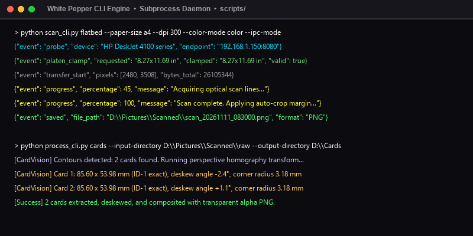
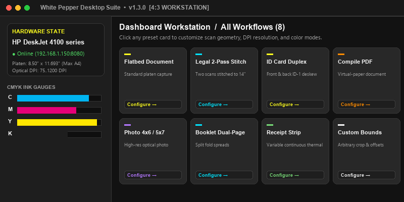
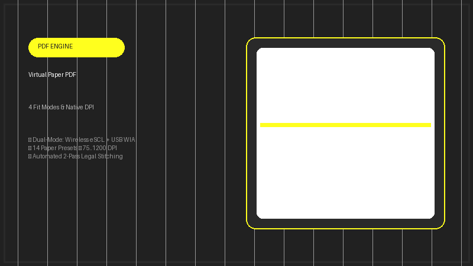

# ⚡ White Pepper CLI Engine 🌶️

📱 **A Standalone, Multi-Protocol Flatbed Scanner Acquisition, Computer Vision & PDF Layout Engine.**

Built in pure Python (`>= 3.11`) with zero GUI dependencies, **White-Pepper-CLI** brings enterprise-grade scanning, hardware protocol abstraction, and computer vision pipelines to command-line automation, background daemons, and custom frontend integrations! Supporting both wireless network eSCL scanners (`AirScan` / `Mopria`) and local Windows WIA USB devices, it handles everything from automatic ID card extraction to 2-pass US Legal document stitching on standard flatbeds. 🚀

* **Homepage & Interactive Documentation**: [https://aceburgundy.github.io/White-Pepper-CLI/](https://aceburgundy.github.io/White-Pepper-CLI/)
* **Flutter Desktop Application Repository**: [https://github.com/AceBurgundy/White-Pepper](https://github.com/AceBurgundy/White-Pepper)
* **Latest GitHub Release (`v1.3.0`)**: [https://github.com/AceBurgundy/White-Pepper-CLI/releases/tag/v1.3.0](https://github.com/AceBurgundy/White-Pepper-CLI/releases/tag/v1.3.0)

---

## 📦 Requirements & Installation

Before running, ensure your environment meets the minimum version constraints:

* **Python (`>= 3.11`)**: The core runtime environment.
* **Operating System**: Windows 10/11 x64 (supports WIA COM + eSCL) or Linux / macOS (supports eSCL AirScan endpoints).
* **Network / USB Scanner**: An eSCL network scanner (`192.168.x.x:8080`) or a USB-attached scanner with Windows WIA drivers installed.

### Option 1: Compiled Windows Setup Installer 💿

Download the pre-compiled installer containing command wrappers and dependencies:

1. Download [`WhitePepper-CLI-Setup-v1.3.0.exe`](https://github.com/AceBurgundy/White-Pepper-CLI/releases/download/v1.3.0/WhitePepper-CLI-Setup-v1.3.0.exe).
2. Follow the setup wizard to install the CLI engine and add `bin/` command launchers (`scan-cli`, `process-cli`, `diagnostics-cli`, `scan-legal`) directly to your system `PATH`.
3. Open any terminal and execute commands directly:
   ```cmd
   scan-cli flatbed --paper-size a4 --dpi 300 --format pdf
   ```

### Option 2: Pip & Virtual Environment 🐍

Install dependencies into your local Python environment:

```bash
# Clone the repository
git clone https://github.com/AceBurgundy/White-Pepper-CLI.git
cd White-Pepper-CLI

# Create virtual environment and activate
python -m venv .venv
.\.venv\Scripts\activate

# Install requirements
pip install -r requirements.txt
```

---

## 🚀 Core Features

* 🌐 **Multi-Protocol Hardware Abstraction:** Direct communication with wireless eSCL endpoints (`AirScan` / `PWG-Raster`) and native Windows WIA COM interfaces (`win32com.client`) with an out-of-process PowerShell fallback bridge.
* 🔍 **Zero-Touch Subnet Discovery:** Automatically broadcasts and probes local network subnets (`/24`) and queries Windows WIA device managers to discover all online scanners in milliseconds.
* 📏 **14 Standard Paper Presets & Custom Geometry:** Accurate optical millimeter and inch calibrations for `full`, `a4`, `letter`, `legal`, `a5`, `a6`, `b5`, `executive`, `statement`, `photo-4x6`, `photo-5x7`, `index-3x5`, `id-card`, `receipt-half`, and `custom` platen bounds.
* 💳 **Automated ID-1 Card Extraction:** Automatically identifies cards placed on the optical platen, isolates edges, straightens skew, crops with customizable corner radii (`3.18 mm` default), and composites onto solid backgrounds.
* 📖 **Continuous Booklet Spread Segmentation:** Loop acquisition with countdown audio cues, splitting continuous book spreads into ordered single pages (LTR or RTL) with RapidOCR upright orientation correction.
* 📑 **2-Pass US Legal Platen Stitcher:** Solves the physical platen limitation of standard flatbed scanners by capturing overlapping halves and performing feature-based image stitching into a unified `8.50" × 14.00"` legal PDF.
* 📑 **Virtual-Paper PDF Layout Engine:** Direct PDF compilation supporting multiple fit modes (`contain`, `fill`, `stretch`, `original`), custom margin geometry, JPEG compression tuning, and metadata injection.

---

## 💻 CLI Walkthrough & Visual Previews

Below is a visual overview and breakdown of the primary CLI entry points and vision routines.

### 1️⃣ Headless CLI Engine Overview ⚡



White Pepper CLI operates with zero GUI dependencies, emitting clean, machine-parseable progress logs and JSON diagnostic payloads suitable for subprocess orchestration and automation scripts.

### 2️⃣ Desktop Suite Integration 🖥️



The CLI engine serves as the exact backend powering the [White Pepper Desktop Workstation](https://github.com/AceBurgundy/White-Pepper), proving complete architectural parity between interactive desktop controls and headless CLI arguments.

### 3️⃣ Hardware Diagnostics & Device Probing 🖨️


Probe any network or USB scanner to retrieve XML capabilities, supported color modes, discrete DPIs, and physical platen limits:

```powershell
# Probe default eSCL host
python diagnostics_cli.py --ip 192.168.1.150 --port 8080

# Emit machine-readable JSON report
python diagnostics_cli.py --json

# Save raw eSCL XML capabilities document
python diagnostics_cli.py --save-capabilities D:\Pictures\Scanned\caps.xml
```

### 4️⃣ Computer Vision & Multi-Pass Stitching 🔍


Process raw image directories, extract ID cards with rounded corner masks, split booklet spreads, or stitch multi-pass scans:

```powershell
# Batch extract and deskew ID-1 cards
python process_cli.py cards --input-dir D:\Pictures\Scanned\raw --output-dir D:\Pictures\Scanned\cards --dpi 600 --background white --format jpg

# Split booklet spreads with RapidOCR auto-orientation
python process_cli.py booklets --input-dir D:\Pictures\Scanned\spreads --output-dir D:\Pictures\Scanned\pages --reading-direction ltr --compile-pdf D:\Pictures\Scanned\booklet.pdf

# Execute 2-pass legal document scan and stitch
python scan_legal_two_pass.py --output-pdf D:\Pictures\Scanned\legal_doc.pdf --dpi 300
```

### 5️⃣ Virtual-Paper PDF Layout Engine 📑



Combine image sequences into structured PDF files with exact margins and virtual paper bounds:

```powershell
python process_cli.py compile-pdf --input-dir D:\Pictures\Scanned\pages --output-file D:\Pictures\Scanned\report.pdf --paper-size a4 --margin-mm 10 --fit-mode contain --jpeg-compression 88 --title "Quarterly Report" --author "AceBurgundy"
```

---

## 🛠️ CLI Command Reference

### `scan_cli.py` — Hardware Acquisition

```powershell
# ISO A4 scan directly to single-page PDF at 300 DPI
python scan_cli.py flatbed --paper-size a4 --dpi 300 --color-mode color --format pdf

# High-resolution 4x6 photo scan with custom offset
python scan_cli.py flatbed --paper-size photo-4x6 --dpi 1200 --intent photo --offset-x 10 --offset-y 10 --units mm --format jpg

# Continuous booklet loop (max 10 spreads, 8s countdown interval)
python scan_cli.py booklet --paper-size a4 --dpi 300 --interval 8 --max-scans 10

# Direct ID-1 card acquisition with white background
python scan_cli.py card --dpi 600 --corner-radius-mm 3.18 --background white --no-prompt
```

---

## 🐍 Programmatic Python Library Usage

You can import `white_pepper` directly into your own Python applications:

```python
from pathlib import Path
from white_pepper import ScanConfiguration, PdfCompilationConfiguration
from white_pepper.hardware import ScannerManager
from white_pepper.document import compile_pdf_with_config

# Initialize the scanner manager
manager: ScannerManager = ScannerManager(
    destination_directory=Path(r"D:\Pictures\Scanned"),
    escl_host="192.168.1.150",
    escl_port=8080,
)

# Configure scan parameters
configuration: ScanConfiguration = ScanConfiguration(
    paper_size="a4",
    resolution_dpi=300,
    color_mode="color",
    output_format="pdf",
)

# Acquire scan from hardware
scanned_file_path: Path = manager.acquire_with_config(configuration)
print(f"Acquired scan saved to: {scanned_file_path}")
```

---

## 🗂️ Project Architecture

```
scripts/
├── bin/                       # Windows .cmd command launcher wrappers
│   ├── scan-cli.cmd
│   ├── process-cli.cmd
│   ├── diagnostics-cli.cmd
│   └── scan-legal.cmd
├── images/                    # Visual assets and workflow previews
├── installer/                 # Inno Setup Windows installer configuration
│   ├── white_pepper_cli_setup.iss
│   └── app_icon.ico
├── white_pepper/              # Core pure-Python library
│   ├── algorithms/            # Vision and geometry routines
│   │   ├── booklet_vision.py  # Dual-page spread segmentation
│   │   ├── card_vision.py     # ID-1 card edge detection & corner masks
│   │   ├── geometry.py        # Optical unit conversions and platen clamping
│   │   ├── legal_vision.py    # 2-pass feature stitcher & seam blender
│   │   └── ocr_orientation.py # RapidOCR text angle detector
│   ├── document/              # Virtual-paper PDF compilation
│   │   └── pdf_builder.py
│   ├── hardware/              # Protocol implementations
│   │   ├── escl_client.py     # eSCL / AirScan HTTP/XML engine
│   │   ├── powershell_bridge.py
│   │   ├── scanner_manager.py # Multi-protocol router
│   │   └── wia_client.py      # Native Windows WIA COM 2.0 client
│   ├── utils/                 # Audio alerts and console logging
│   └── config.py              # Strongly-typed dataclass configurations
├── scan_cli.py                # Hardware scanning entry point
├── process_cli.py             # Vision & PDF compilation entry point
├── diagnostics_cli.py         # Scanner probe & discovery entry point
└── scan_legal_two_pass.py     # Legal 2-pass workflow entry point
```

---

## 🔗 Links & Repositories

* **CLI Engine Repository**: [https://github.com/AceBurgundy/White-Pepper-CLI](https://github.com/AceBurgundy/White-Pepper-CLI)
* **Desktop Workstation Repository**: [https://github.com/AceBurgundy/White-Pepper](https://github.com/AceBurgundy/White-Pepper)
* **Interactive Documentation Portal**: [https://aceburgundy.github.io/White-Pepper-CLI/](https://aceburgundy.github.io/White-Pepper-CLI/)
* **Releases & Binary Downloads**: [https://github.com/AceBurgundy/White-Pepper-CLI/releases](https://github.com/AceBurgundy/White-Pepper-CLI/releases)

---

## 📜 License

This project is licensed and distributed under the **Mozilla Public License 2.0 (MPL-2.0)**.

## 👤 Author

* **Name:** AceBurgundy
* **Email:** Samadriansabalo99@gmail.com
* **GitHub:** [@AceBurgundy](https://github.com/AceBurgundy)
