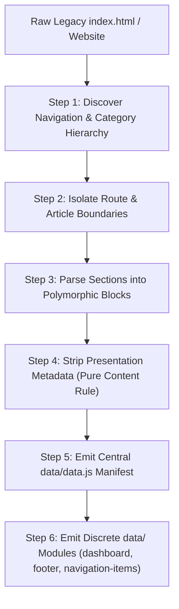

# Project Architectural Guide & Living Rules (`book.md`)

This document serves as the authoritative, framework-agnostic architectural guide, data layer specification, and living ruleset for web applications, dashboards, and documentation systems built upon the **`Lite-SPA-JS`** architecture (a lightweight single-page application engine leveraging `Component.js`, reactive signals, declarative templates, scoped CSS loading, dynamic module loading, and pure ES modules).

This guide is designed as an executable, universal standard across projects and provides a complete blueprint for migrating legacy websites or constructing new applications from scratch.

---

## 1. Core Engine Philosophy & Architectural Principles

1. **Lightweight Component-Driven Engine (`Lite-SPA-JS`):** The application is decomposed into small, discrete, composable component classes inheriting from `Component`.
2. **Reactive State & Declarative Templates:** UI state transitions are driven by reactive signals (`signal()`) and declarative tagged template literals (`html`...``).
3. **Encapsulated Scoped Styling:** Stylesheets are modular and scoped to their respective components using `css(import.meta, ["../styles/...css"])` or global foundational stylesheets.
4. **Dynamic Asynchronous Lifecycle:** Viewports and pages load asynchronously via pure ES module imports or dedicated data loaders, maintaining smooth navigation without full browser refreshes.

---

## 2. JavaScript Code & Documentation Conventions

All JavaScript code within the application must strictly adhere to clean code and documentation standards:

* **Strict JSDoc Type Annotations:** Every variable declaration (`const`, `let`), function/method parameter, return value, class field, and object property must have explicit JSDoc `@type` annotations.
* **Typed Collections & Explicit Generic Unions:** Collections must explicitly declare generics (e.g. `Array<string>`, `Record<string, unknown>`, `Map<string, Component>`). Nullable or optional properties must use explicit unions (e.g. `string|null`, `HTMLElement|undefined`).
* **Zero Abbreviations Policy (Identifiers, Files & Directories):**
  * Never use abbreviations or truncated acronyms in variable names, function names, class names, CSS class names, OR directory and file names.
  * *Standard Rules:*
    * Use `navigation` instead of `nav`.
    * Use `button` instead of `btn`.
    * Use `configuration` instead of `cfg` or `config`.
    * Use `element` instead of `el`.
    * Use `response` instead of `resp` or `res`.
    * Use `request` instead of `req`.
    * Use `index` instead of `idx` or `i`.
    * Use `table-of-contents` instead of `toc`.
    * Use `description` instead of `desc`.
    * Use `source` instead of `src` (except for native HTML attributes).
  * Follow `camelCase` for variables and methods, `PascalCase` for classes and components, `UPPER_SNAKE_CASE` for immutable constants, and `kebab-case` with full descriptive words for files and directories.
* **No Decorative Section Banners:** Decorative ASCII banner comments (e.g. `// ==================`) are strictly prohibited. Structure code using clean JSDoc headers and concise inline comments.
* **Comprehensive JSDoc Documentation Blocks:** Every class, constructor, public method, and exported helper must include a descriptive JSDoc block explaining its purpose, arguments, and return types.

---

## 3. Directory Taxonomy: Group Folders vs Component Folders

To maintain clean separation of concerns and intuitive navigation across large codebases, directories are strictly categorized into **Group Folders** and **Component Folders**.

```text
src/
├── common/                              # Global foundational infrastructure
│   ├── assets/                          # Universal static assets (logos, icons)
│   ├── scripts/                         # Global universal helpers (theme, data loader)
│   └── styles/                          # Global design tokens, resets, typography
├── components/                          # UI Component Tree
│   ├── pages/                           # Group Folder: Top-level route pages
│   │   ├── application/                 # Component Folder: App shell container
│   │   └── dashboard/                   # Component Folder: Home / Dashboard view
│   ├── sections/                        # Group Folder: Multi-widget layout sections
│   │   ├── app-header/                  # Component Folder: Header section
│   │   ├── navigation-sidebar/          # Component Folder: Sidebar section
│   │   └── site-footer/                 # Component Folder: Footer section
│   └── widgets/                         # Group Folder: Reusable standalone widgets
│       ├── badge-list/                  # Component Folder (Plural Container)
│       ├── navigation-menu/             # Component Folder
│       ├── search-modal/                # Component Folder
│       └── section-blocks/              # Group Folder: Domain-grouped widgets
│           ├── cards/                   # Component Folder (Plural Container)
│           ├── code-block/              # Component Folder
│           ├── table-block/             # Component Folder
│           └── image-block/             # Component Folder
└── data/                                # Central data layer and content manifests
    ├── data.js                          # Master manifest and routing registry
    ├── dashboard.js                     # Root / Home view content specification
    ├── footer.js                        # Global footer content specification
    └── navigation-items/                # Discrete route/page content modules
        ├── page-slug-one.js
        ├── page-slug-two.js
        └── ...
```

### A. When a Folder Must Be a Group Folder
A directory must be structured as a **Group Folder** when it serves as a taxonomic category grouping multiple independent component folders that share a domain, layout tier, or polymorphic interface.

* **Characteristics of a Group Folder:**
  * It does **NOT** contain `templates/`, `styles/`, or `scripts/` directories at its own root.
  * It does **NOT** contain component JavaScript classes directly at its root.
  * It acts purely as a namespace container for child component folders (e.g. `components/widgets/section-blocks/` grouping `cards/`, `code-block/`, `table-block/`, `image-block/`).

### B. When a Folder Must Be a Component Folder
A directory must be structured as a **Component Folder** when it represents a single discrete functional UI element, a composite layout widget, or a plural container with its sub-elements.

* **Standard Component Folder Anatomy:**
  Every component folder must strictly follow the tripartite structure:
  ```text
  <component-name>/
  ├── templates/
  │   ├── <component-name>.js              # Main component class (or plural container)
  │   └── <component-name>__<subpart>.js   # Decomposed sub-components / child items
  ├── styles/
  │   ├── <component-name>.css             # Dedicated styling for main component
  │   └── <component-name>__<subpart>.css  # Dedicated styling for sub-components
  └── scripts/                             # (Optional) Component-scoped helpers & controllers
      └── <component-name>__<helper>.js
  ```

---

## 4. Resource Scoping: Component-Scoped vs Global `common/`

To prevent global namespace pollution and ensure maximum modularity, resource placement must follow strict scoping criteria.

### A. Component-Scoped Resources (`<component>/scripts/` and `<component>/styles/`)
A script, style, helper, service, enum, or transformer **must** be co-located inside the component's own folder if:
1. It is built specifically to support that component's internal logic, interaction, or layout.
2. It interacts directly with that component's private DOM elements, CSS classes, or internal signals.
3. It is not consumed by unrelated components across different domains.
* *Examples:* Custom scrollbar controllers, drag-and-drop or touch-swipe gestures, clipboard copy handlers, or component-specific image aspect-ratio scalers.

### B. Global Common Resources (`common/`)
A resource qualifies for placement in the root `common/` directory **only if** it meets all three of the following invariants:
1. **Multi-Consumer Utility:** It is consumed by two or more completely independent components across different architectural domains OR directly by the application root bootstrap.
2. **Domain Agnosticism:** It provides generic, reusable infrastructure without knowledge of any specific component's private markup, CSS selectors, or internal hierarchy.
3. **Foundational Architecture:** It manages universal capabilities (e.g., color theme managers, root viewport scalers, centralized dataset loaders, design tokens, and CSS reset foundations).

---

## 5. Plural Container Nomenclature & Component Architecture

* **Plural Container Nomenclature Invariant:**
  When a component acts as a parent container managing or iterating over multiple instances of a child component, the parent component class, its directory, and its primary template file must be named using the **plural form**, while the child item uses the **singular form**.
  * *Canonical Architectural Patterns:*
    * Container `Cards` (`cards/templates/cards.js`) renders multiple `Card` (`cards/templates/card.js`) items.
    * Container `Tabs` (`tabs/templates/tabs.js`) renders multiple `TabItem` (`tabs/templates/tabs__item.js`) items.
    * Container `BadgeList` (`badge-list/templates/badge-list.js`) renders multiple `BadgeListItem` (`badge-list/templates/badge-list__item.js`) items.
    * Container `TableOfContents` (`table-of-contents/templates/table-of-contents.js`) renders multiple `TableOfContentsItem` (`table-of-contents/templates/table-of-contents__item.js`) items.
    * Container `NavigationCategory` (`navigation-category/templates/navigation-category.js`) renders multiple `NavigationCategoryItem` (`navigation-category/templates/navigation-category__item.js`) items.

* **Strict BEM CSS Notation:** All CSS class names must strictly conform to standard BEM conventions (`block__element--modifier`).
* **Strict 800-Line Limit per File:** No component template, script, or stylesheet may exceed 800 lines of code. Components exceeding this threshold must be decomposed into sub-components or extracted pure JavaScript helpers.
* **Declarative Template Isolation:** CSS must never be declared inline within HTML markup or injected dynamically via JavaScript strings. All visual rules must reside in dedicated `.css` files loaded via `css(import.meta, [...])`.

---

## 6. Data Layer Architecture & Pure Content Separation

The `data/` directory is the central nervous system of any `Lite-SPA-JS` application. It cleanly decouples all content and navigation structure from presentation and rendering components.

### A. Root `data/` Directory Breakdown
```text
data/
├── data.js                              # Master Manifest Registry
├── dashboard.js                         # Homepage / Dashboard Specification
├── footer.js                            # Global Site Footer Specification
└── navigation-items/                    # (or items/) Individual Page Content Modules
    ├── <page-slug-one>.js
    ├── <page-slug-two>.js
    └── ...
```

### B. Module Contracts & Schemas

#### 1. Master Manifest Registry (`data/data.js`)
The single entry point and registry for the application's information architecture. It maps primary singleton routes and categorized navigation hierarchies:
```javascript
window.DOCUMENTATION_DATA = {
  "dashboard_path": "data/dashboard.js",
  "footer_path": "data/footer.js",
  "category_groups": [
    {
      "category_title": "Getting Started",
      "navigation_item_paths": [
        "data/navigation-items/overview-and-tenets.js",
        "data/navigation-items/installation-and-setup.js"
      ]
    },
    {
      "category_title": "Components & APIs",
      "navigation_item_paths": [
        "data/navigation-items/dialogs.js",
        "data/navigation-items/styles-api.js"
      ]
    }
  ]
};
```

#### 2. Page Content Specification Modules (`data/navigation-items/<slug>.js`)
Each discrete route or documentation article defines its content structure:
```javascript
window.DOCUMENTATION_ITEMS = window.DOCUMENTATION_ITEMS || {};
window.DOCUMENTATION_ITEMS["data/navigation-items/overview.js"] = {
  "item_title": "Overview & Tenets",
  "header_container": {
    "title": "Core Architecture",
    "description": "Comprehensive guide to application design principles.",
    "badge_list": [
      { "label": "Version 1.0", "icon_name": "verified" },
      { "label": "TypeScript Ready", "icon_name": "code" }
    ],
    "banner_image": {
      "image_url": "common/assets/hero.svg",
      "alt_text": "Architecture Overview"
    }
  },
  "tab_list": [
    {
      "tab_title": "Design Principles",
      "tab_slug": "design-principles",
      "section_blocks": [
        /* Array of Polymorphic Section Blocks */
      ]
    }
  ],
  "hide_tabs": false,
  "hide_toc": false
};
```

#### 3. Polymorphic Section Block Schemas
Content within `section_blocks` is represented using strict, polymorphic block schemas:
* **Paragraph Block (`block_type: "paragraph"`):**
  ```json
  {
    "block_type": "paragraph",
    "heading": "Modular Layouts",
    "content": "Detailed descriptive markdown or HTML paragraph."
  }
  ```
* **Code Block (`block_type: "code"`):**
  ```json
  {
    "block_type": "code",
    "heading": "Basic Installation",
    "language": "bash",
    "code_content": "npm install @app/core",
    "filename": "Terminal"
  }
  ```
* **Table Block (`block_type: "table"`):**
  ```json
  {
    "block_type": "table",
    "heading": "Configuration Properties",
    "columns": ["Property", "Type", "Default", "Description"],
    "rows": [
      ["theme", "string", "'light'", "Active color scheme identifier"],
      ["autoPreload", "boolean", "true", "Enables background script preloading"]
    ]
  }
  ```
* **List Block (`block_type: "list"` or `"diamond_list"`):**
  ```json
  {
    "block_type": "diamond_list",
    "heading": "Core Highlights",
    "items": [
      "Zero-configuration dynamic loader",
      "Comprehensive mobile gesture navigation"
    ]
  }
  ```
* **Cards Container Block (`block_type: "cards"`):**
  ```json
  {
    "block_type": "cards",
    "heading": "Featured Components",
    "orientation": "row",
    "card_items": [
      {
        "label": "Guide",
        "title": "Getting Started",
        "description": "Step-by-step onboarding walkthrough.",
        "link_url": "data/navigation-items/installation.js",
        "image_url": "common/assets/card-guide.svg",
        "image_scale": 0.9
      }
    ]
  }
  ```
* **Image / Media Block (`block_type: "image"`):**
  ```json
  {
    "block_type": "image",
    "heading": "System Diagram",
    "image_url": "common/assets/diagram.svg",
    "caption": "High-level module interaction flow"
  }
  ```

#### 4. Global Footer Specification (`data/footer.js`)
```javascript
window.DOCUMENTATION_ITEMS = window.DOCUMENTATION_ITEMS || {};
window.DOCUMENTATION_ITEMS["data/footer.js"] = {
  "brand_name": "Project Brand",
  "brand_description": "Comprehensive application narrative and overview.",
  "social_links": [
    { "icon_name": "code", "platform_name": "GitHub", "url": "https://github.com/..." },
    { "icon_name": "language", "platform_name": "Website", "url": "https://..." }
  ],
  "columns": [
    {
      "column_title": "Resources",
      "links": [
        { "label": "Documentation", "url": "#" },
        { "label": "Changelog", "url": "#" }
      ]
    }
  ],
  "legal_links": [
    { "label": "Privacy Policy", "url": "#" },
    { "label": "License", "url": "#" }
  ],
  "copyright_text": "© 2026 Project Contributors. Licensed under MIT / MPL-2.0."
};
```

---

## 7. Migration & Deconstruction Guide: Converting Any Monolithic `index.html` to `data/`

When migrating an existing website or monolithic `index.html` into a `Lite-SPA-JS` application, execute this deterministic 6-step extraction algorithm:



### Step 1: Discover Navigation Hierarchy
* Inspect legacy navigation elements (`<nav>`, `.sidebar`, `<aside>`, `.nav-group`, accordion menus).
* Extract category group titles (e.g., `"Foundations"`, `"Components"`, `"API Reference"`) and their child page links/slugs.

### Step 2: Isolate Route & Article Boundaries
* For each page/route, extract the hero header container:
  * Title (`<h1>`, `.banner-title`)
  * Subtitle / Description (`<p class="subtitle">`, `.banner-description`)
  * Badges / Metadata chips (`.badge`, `.chip`, `.tag`)
  * Hero graphic (`.hero-image`, `.mockup-card`, ``)
* Identify tabbed articles (`.tabs`, `.tab-pane`, `<article>`).

### Step 3: Parse Sections into Polymorphic Block Objects
* Iterate through each content section in the legacy markup:
  * Text paragraphs & blockquotes ➔ `block_type: "paragraph"`
  * Code blocks (`<pre><code>`) ➔ `block_type: "code"` (extract language & code text)
  * Data tables (`<table>`) ➔ `block_type: "table"` (extract headers `<th>` and rows `<td>`)
  * Bullet / Feature lists (`<ul>`, `<ol>`) ➔ `block_type: "diamond_list"` / `"list"`
  * Card grids (`.card`, `.grid-item`) ➔ `block_type: "cards"`
  * Media illustrations (`<figure>`, ``) ➔ `block_type: "image"`

### Step 4: Strict Content Normalization & Presentation Stripping (Pure Content Invariant)
* **Remove all presentation/layout flags:** Strip hardcoded CSS utility classes, inline style strings, `heading_level` numbers, column span counts, or device toggles from the dataset.
* **Normalize Generic Nomenclature:** Replace context-locked keys (e.g. `date`) with generalized keys (e.g. `label`).
* All typographical sizing, spacing, and layout calculations are the exclusive responsibility of the rendering components.

### Step 5: Emit the Master Manifest (`data/data.js`)
* Assemble all extracted category groups and their respective item paths into `window.DOCUMENTATION_DATA`.

### Step 6: Emit Individual Specification Modules
* Write `data/dashboard.js` for the homepage overview.
* Write `data/footer.js` for global links and copyright.
* Write `data/navigation-items/<slug>.js` for each individual page.

---

## 8. Dynamic Script-Based Data Loading Invariant

In `Lite-SPA-JS`, data modules are structured as JavaScript files that register their payloads to a global dictionary (`window.DOCUMENTATION_ITEMS[path] = { ... }`), loaded dynamically via script injection or dynamic imports.

* **Why Script-Based Registry over Monolithic JSON / `fetch()`?**
  1. **Zero-CORS Local Execution:** Standard `fetch("./data.json")` throws `CORS (Cross-Origin Resource Sharing)` security errors when opened directly from a local filesystem (`file:///`). Script tag loading functions universally without requiring a local web server.
  2. **Lazy On-Demand Resolution:** Pages are only fetched and parsed into memory when navigated to, minimizing memory consumption and initial parse time.
  3. **Non-Blocking Background Preloading:** Once the active page is rendered, background workers or async script injectors prefetch all remaining data modules during idle intervals, guaranteeing zero-latency navigation transitions.

---

## 9. Application Bootstrapping, FOUC Prevention & Lifecycle Management

* **HTML Entry Point (`index.html`):** The primary application entry script must be loaded as an ES module in the document `<head>`:
  ```html
  <script type="module" src="./script.js"></script>
  ```
* **Lightweight Bootstrap (`script.js`):** Serves exclusively as the application bootstrap, mounting the root application shell into the DOM.
* **FOUC Prevention via Dedicated `LoadingScreen` Component:**
  * To eliminate Flash of Unstyled Content (FOUC) and heavy initial paint delays, the root application initializes a lightweight, dedicated `LoadingScreen` component that mounts immediately with minimal markup and smooth CSS animations while critical route data is fetched.
* **Deferred Background Preloading Strategy:**
  * Once the initial page view is successfully rendered and the loading screen is smoothly dismissed, the application triggers non-blocking background preloading (`preloadAllNavigationItems`) for all remaining navigation modules and footers, ensuring subsequent route transitions are instantaneous with zero network latency.

---

## 10. Universal Design & Layout Invariants (Living Engineering Rules)

To ensure pixel-perfect fidelity, visual harmony, and prevent regressions across viewports, every component implementation must strictly enforce these foundational rules:

### A. 1:1 Spatial & Dimensional Fidelity (Margins, Paddings, Gaps & Sizing)
* **Exact Metric Mapping:** All container paddings, element margins, gaps, widths, and heights must match reference specifications.
* **No Spurious Positional Resets:** Never introduce ad-hoc positional overrides (such as `:first-child`, `:last-child`, or `:first-of-type` margin/padding resets) unless explicitly engineered in the design reference. Visual rhythms rely on uniform margins across repeated elements.
* **Invariant Dimension Locking:** Elements with fixed dimensions (e.g. icon buttons, badges, rail columns) must maintain their exact sizes across breakpoints without inventing unprompted media query scalers.

### B. Universal Flexbox & Grid Text Truncation (`min-width: 0` & Ellipsis)
* **Flexbox Child Truncation Rule:** Because flex items default to `min-width: auto`, any flex or grid container and its child elements that host textual content (labels, placeholders, titles, captions, badges) must declare `min-width: 0` whenever the text could potentially exceed the container width or compress adjacent sibling elements.
* **Single-Line Ellipsis Rule:** Any textual element intended to remain on a single line without wrapping must explicitly combine:
  ```css
  min-width: 0;
  white-space: nowrap;
  overflow: hidden;
  text-overflow: ellipsis;
  ```
* **Sibling Protection Rule:** Sibling elements placed alongside truncatable text (such as action buttons, chips, icons, or badges) must declare `flex-shrink: 0; white-space: nowrap;` to prevent adjacent text from squishing or distorting their geometry.

### C. Relative Parent Containment & Column Nesting
* **Percentage Containment Rule:** When nesting a component inside a parent container that is already percentage-constrained (e.g. an 18% rail or a 50% split column), the inner component must always declare `width: 100%; max-width: 100%;` rather than re-applying the percentage constraint, which would multiply percentages (`18% * 18% = 3.24%`) and compress content into single-character columns.

### D. Multi-Instance State Synchronization
* **Global UI State Sync:** Whenever an interactive state updates (e.g. color theme toggles, route changes, drawer states, tab selections), the controller routine must query and synchronize all corresponding UI elements across all viewports (e.g. desktop sidebars, topbars, drawers, modals) simultaneously rather than updating only the single triggered instance.

### E. Semantic Tag Hygiene & User-Agent Style Isolation
* **Browser-Default Reset:** When using HTML tags that carry heavy browser user-agent defaults (such as `<kbd>`, `<pre>`, `<table>`, `<button>`, `<blockquote>`), all default borders, outlines, monospace typography, line-heights, and margins must be explicitly styled or replaced with styled semantic wrappers (`<span>`, `<div>`) to prevent unwanted visual quirks.

### F. Complete Sensory & Feedback Parity
* **User Feedback Parity:** Every user feedback mechanism present in the reference design (toast notifications, clipboard confirmations, hover transitions, active press transforms, focus rings) must be fully wired and active.

### G. Typography & Text-Transform Hierarchy
* **Casing Hierarchy:** Section headers and categorization bars often specify `text-transform: uppercase` with tracking (`letter-spacing: 0.8px`). In contrast, navigation item links, button labels, and body text must always preserve their natural casing (`text-transform: none`) so proper nouns, package names, and technical terms render correctly.

### H. Fluid Root Scaling Integrity (No Double-Scaling)
* **Root Scale Independence:** When the layout foundation relies on a fluid root scaling system (e.g. `html { font-size: clamp(...) }`), avoid hardcoding component-level `@media (min-width: 1920px)` dimensional increases (heights, paddings, font sizes), as the fluid root font size already scales all `rem` units proportionately. Adding component-level overrides creates an unintended double-scaling distortion on large displays.

### I. Authoritative Specification Data Binding
* **Dynamic Specification Binding:** Components that display descriptive titles, headers, or metadata must dynamically load and bind the authoritative specification property from the loaded data modules. File-name slug fallbacks (e.g. regex replacement of `-` with spaces) must strictly serve as temporary fallback initializers and never permanently supersede official specification content.

### J. Contextual Submenu Indentation & Spatial Hierarchy
* **Visual Sub-Hierarchy:** Submenu items and secondary drilldown navigation rows must preserve their intended spatial hierarchy (e.g. `width: 90%; margin-left: auto;` inside right-aligned flex containers with `align-items: flex-end`), ensuring nested options have clear visual indentation and distinction from top-level category triggers.

### K. Strict Attribute Quoting & Interpolation Hygiene in Reactive Templates
* **Attribute Quoting Invariant:** In tagged template literals (`html`...``), all dynamic attribute values must be enclosed in double quotes (e.g. `class="${className}"`, `src="${imageSource}"`, `aria-checked="${isChecked}"`). Omitting quotes around dynamic expressions causes multi-token strings (such as space-separated CSS classes) to be parsed as separate standalone HTML attributes (e.g. producing `<h1 class="foo" bar="">` instead of `<h1 class="foo bar">`).

### L. Safe Slot Content Fallbacks & Specification Casing Parity
* **Slot Collision Avoidance:** Components rendering dynamic properties must provide fallback strings (e.g. `property || ""`) and exhaustively support both specification formats (`snake_case` properties from JSON/JS spec files such as `icon_name`, `badge_label`, `mockup_image_path`, as well as `camelCase` identifiers). In single-file reactive engines, unpopulated or undefined template values leave empty slot comment anchors that can collide with and capture parent-level sibling interpolations.

### M. Lead Element & List Anchor Preservation
* **Lead Anchor Parity:** When a repeated collection or badge group in the reference design incorporates an invariant lead indicator (such as an invariant category badge preceding dynamic badges), the container component must consistently instantiate and preserve this lead anchor before appending dynamic items.

### N. Sticky Element Track Isolation & Dual-Axis Shrink Alignment
* **Shrink Track Architecture:** When sticky floating navigation controls contract to match specific layout columns (e.g. `--content-pane-width`), the outer sticky container must stay transparent with `display: flex; justify-content: flex-end;`, while the inner track element owns the background color, shape radius, and smooth dual-axis transition (`transition: max-width 0.3s cubic-bezier(0.2, 0, 0, 1), margin-right 0.3s cubic-bezier(0.2, 0, 0, 1);`). When stuck, the track transitions to match the main content pane width and right margin without leaving residual background artifacts.

### O. Natural Heading Spacing Rhythms & Contextual Top Margins
* **Desktop Rhythms vs Mobile Resets:** Section headings rely on substantial desktop top margins to establish visual separation from floating headers; never inject desktop `:first-child { margin-top: 0 !important; }` resets that destroy this breathing room. On mobile viewports, synchronize first-child heading resets only when container layout gaps already provide the intended spacing.

### P. Zero Abbreviations Policy (Full-Word Nomenclature & Semantic Clarity)
* **Explicit Full-Word Identifiers:** Abbreviations and acronyms are strictly prohibited across modern component classes, HTML attributes, data attributes (`data-table-of-contents-container`), CSS custom properties, and JavaScript variable bindings. Always spell out identifiers in full (`TableOfContents`, `.table-of-contents__item-link`, `data-target-identifier`) to maximize architectural readability, maintainability, and searchability.
* **Full Title Display with Ellipsis Overflow:** Table of Contents item labels must render the complete heading title string from the target section rather than arbitrarily truncating words. Display the full label on desktop while enforcing single-line text ellipsis (`min-width: 0; width: 100%; white-space: nowrap; overflow: hidden; text-overflow: ellipsis;`) to prevent label wrap distortions while preserving full title tooltip hover parity (`title="${fullTitle}"`).

### Q. Sticky Background Masking & Top Overflow Protection
* **Conditional Sticky Header Mask:** When sticky navigation elements stick to `top: 0` inside a scrollable viewport that declares top padding, scrolled content passing underneath can peek through the top padding gap above the sticky bar. Ensure the sticky top barrier is conditionally activated only when stuck (e.g. using `::before { top: -0.625rem; height: 0.625rem; opacity: 0; } .is-stuck::before { opacity: 1; }`) matching the exact viewport padding, ensuring it never encroaches upon or obscures hero banners when the page is at the top.

### R. Modular Stylesheet Isolation & Zero Duplicate Imports
* **Single-Source Component Stylesheet Loading:** In component-driven single-page application architectures where each JavaScript component imports its own scoped CSS via `css(import.meta, ["../styles/...css"])`, global entry stylesheets must strictly import only foundational environment tokens (fonts, resets, design tokens, and theme palettes). Never re-import component-specific stylesheets in global entry stylesheets, as doing so causes the browser to register duplicate stylesheet rules in the DOM, forcing developers to uncheck rules twice in DevTools.

### S. Single-Source Event Binding Invariant (No Redundant Manual DOM Listeners)
* **Idempotent Component Event Binding:** In `Component.js`-based architectures, interactive subcomponents declare declarative event handlers in their template literals (e.g. `onclick=${handleItemClick}`). Parent components must never attach duplicate manual `addEventListener("click", ...)` listeners on the same DOM elements or parent containers alongside the component's internal event bindings. Adding manual DOM listeners causes a single user click to fire multiple handler callbacks in rapid succession, resulting in severe state skipping bugs. Rely solely on the component's declarative event handlers and reactive signals for state transitions.

### T. Border-Radius Stacking & Overlap Pattern (Stacked Media Compartments)
* **Seamless Compartment Stacking:** When rendering cards with separate media headers and text content compartments, both the media container and the content body share the same corner radius token (`border-radius: var(--sys-shape-corner-large)`).
* **Negative Margin Elevation Overlap:** In column orientation, the media container is elevated with `z-index: 1` and declared with a negative bottom margin equal to the corner radius (`margin-bottom: calc(-1 * var(--sys-shape-corner-large))`). This causes the rounded bottom edge of the image container to visually overlap the rounded top edge of the content container below it, creating a unified stacked aesthetic. In row orientation, the negative margin resets to `0`. The card root enforces `overflow: hidden; border-radius: var(--sys-shape-corner-large);` to clip outer boundaries cleanly.

### U. Interactive Boundary Isolation & Compartment Hover Targeting
* **Compartment-Targeted Hover Transitions:** On interactive cards or list items with links, hover and focus-visible background color changes (e.g. transitioning from surface-container-low to surface-container-high) must apply strictly to the interactive content body rather than shifting the outer card wrapper or altering non-interactive media header containers.

### V. Source-Agnostic Media Handling & Aspect Ratio Resilience
* **Source-Agnostic Asset Rendering:** Media and card components must support arbitrary image sources (local relative paths, remote CDN URLs, programmatic SVG avatars, and abstract geometric SVG/CSS illustrations).
* **Layout Shift Prevention:** Media containers must declare fixed or proportional heights/aspect-ratios with `object-fit: contain` or `cover`, ensuring smooth rendering and zero Cumulative Layout Shift (CLS) during async image resolution.

### W. Two-Row Global Footer Architecture
* **Global 2-Row Footer Structure:** Global site footers must adhere to a standardized two-row hierarchy:
  * **Row 1 (Narrative & Multi-Column Navigation):**
    * *Left Column:* Author/Brand narrative introduction, mission statement, and social channels.
    * *Right Column:* Balanced, responsive multi-column navigation grid (e.g. 3 columns on row 1 + 2 columns on row 2 across fractional column grids).
  * **Row 2 (Legal & Governance Bar):** Bottom row containing legal/policy links, repository links, license terms, and copyright notices.

### X. Dual-Phase Mobile Navigation Drawer & Active Submenu Memory
* **Two-Phase Mobile Drawer Operation:** On mobile devices, the navigation drawer operates in two interchangeable views:
  1. *Header Group Index:* Top-level category sections.
  2. *Category Submenu View:* Specific page links for the selected category.
* **Active State Memory Invariant:** When a user selects a sub-item, the drawer dismisses. Upon reopening the drawer, it must automatically restore the Category Submenu view corresponding to the currently active page rather than resetting to the root header index, preventing unnecessary extra navigation taps.

### Y. Comprehensive Responsive Breakpoint Matrix & Device Rhythms
* **Ultra-Wide / High-Resolution Displays (`min-width: 2560px`):** Layouts must preserve proportional scaling and prevent content pane over-expansion; maintain fluid clamp-based root scaling without injecting redundant font-size overrides.
* **Tablet Portrait / Mid-Size Viewports (`768px - 1024px`):** Banners retain natural horizontal row layouts or proportional hero dialog scaling; section blocks apply comfortable reading padding; headings maintain clean typographical hierarchy.
* **Mobile Viewports (Portrait & Landscape `max-width: 768px`):**
  * Navigation collapses into the dual-phase mobile drawer and top bar.
  * Tab navigation supports touch swipe gestures and drag-scrolling with smooth opposite button navigation.
  * Data tables transform into horizontally scrollable surfaces with interactive smooth-drag scrollbar thumb indicators.
  * Section blocks maintain comfortable mobile edge spacing and reduced code block font sizing.
